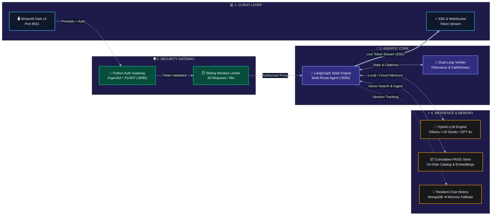
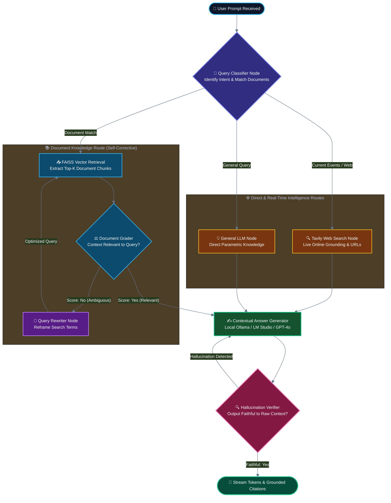

# 🧠 SynapseRAG

### *Autonomous Self-Correcting Multi-Route Agentic Knowledge & Retrieval Engine*

[](https://www.python.org/)
[](https://python.langchain.com/langgraph/)
[](https://fastapi.tiangolo.com/)
[](https://streamlit.io/)
[](https://ollama.com/)
[](https://github.com/facebookresearch/faiss)
[](https://jwt.io/)

---

## ⚡ Executive Summary

**SynapseRAG** is an enterprise-grade, agentic retrieval and question-answering system engineered to transcend the limitations of naive RAG architectures. Traditional RAG systems suffer from blind retrievals, hallucinated citations, vendor lock-in, and costly cloud API dependencies.

SynapseRAG introduces **autonomous intent-routing**, **self-reflective document grading**, **iterative query rewriting**, **automated answer hallucination verification**, and **instant local-AI auto-discovery (Ollama & LM Studio)**—all packaged in a production-ready, pure-Python microservice architecture with real-time token streaming via Server-Sent Events (SSE) and WebSockets.

---

## 🎯 Critical Problems Solved by SynapseRAG

| Problem in Naive RAG | How SynapseRAG Solves It |
| :--- | :--- |
| **Hallucinations & Context Blindness** | Employs an internal **Dual-Verification Loop**: retrieved documents are graded for relevance, and generated answers are audited against raw retrieved context before output. |
| **Rigid "One-Size-Fits-All" Retrieval** | Implements a **LangGraph stateful router** that classifies prompts into: (1) Local Document QA, (2) Global Intelligence, or (3) Real-Time Web Grounding. |
| **Sky-High Cloud Costs & Data Privacy Leaks** | Features **Zero-Config Local AI Discovery**: auto-binds to local Ollama (`llama3.2`, `mistral`, `deepseek-r1`) or LM Studio servers. Never leaks sensitive documents to external clouds when running locally. |
| **Loss of Ingested Documents on Restart** | Upgrades in-memory vector storage into a **Cumulative On-Disk FAISS Store** with an active JSON catalog (`documents_catalog.json`) that preserves chunk counts and metadata across system reboots. |
| **Unverifiable AI Claims** | Injects metadata (filename, page numbers, web URLs) into every chunk and appends **Grounded Source Citations** directly to the live streaming response. |
| **Database Outages Halting the App** | Features a **Fault-Tolerant Memory Layer** with a 2-second timeout and automatic fallback to in-memory session history when MongoDB is unreachable. |
| **Unprotected API Endpoints & Foreign Toolchains** | Replaces complex foreign toolchains with a pure-Python **FastAPI Auth Gateway** with Argon2id password hashing, signed JWTs, and sliding-window rate limiting (30 req/min). |

---

## 🏛️ System Architecture & Workflow

### 1. High-Level System Topology

```
=============================================================================================
                                SYNAPSERAG SYSTEM TOPOLOGY
=============================================================================================

 [ CLIENT TIER ]
        │
        ├──▶ Streamlit Dark-Tech UI (Port 8501)
        └──▶ External REST / WebSocket / SSE Clients
                   │
                   ▼  HTTPS / Bearer JWT  (X-API-TOKEN)
 [ GATEWAY & SECURITY TIER ]
        │
        ├──▶ Python Auth Gateway (:8080)
        │      ├── Argon2id Password Verifier
        │      ├── HMAC-SHA256 JWT Token Issuer
        │      └── Sliding-Window Rate Limiter (30 req/min per client)
        │
        ▼  Proxied SSE Stream / Internal REST
 [ AGENTIC ORCHESTRATION ENGINE (LangGraph v0.5) ]  (:8000)
        │
        ├───▶ [NODE: Query Classifier] ────────────┐
        │        Identifies User Intent            │
        │                                          │
        ├───▶ [ROUTE 1: Local Knowledge QA]        ├───▶ [ROUTE 2: General LLM]
        │        │                                 │        Direct Parametric Knowledge
        │        ▼                                 │
        │     [NODE: FAISS Retriever]              └───▶ [ROUTE 3: Live Web Search]
        │        │                                          Tavily Search Engine
        │        ▼
        │     [NODE: Document Grader]
        │        ├── Score: "No" ──▶ [NODE: Query Rewriter] ──▶ (Re-retrieve Context)
        │        └── Score: "Yes" ─┐
        │                          │
        │                          ▼
        │     [NODE: Answer Generator]
        │        │
        │        ▼
        │     [NODE: Hallucination Verifier]
        │        ├── Faithful == False ──▶ (Regenerate / Self-Correct)
        │        └── Faithful == True  ──▶ Stream Tokens + Grounded Citations
        │
        ▼
 [ HYBRID INFERENCE & STORAGE TIER ]
        ├── Local Inference Engine   : Ollama (:11434) / LM Studio (:1234)
        ├── Cloud Inference Engine   : OpenAI GPT-4o
        ├── On-Disk Vector Engine    : FAISS Index (faiss_index/) + documents_catalog.json
        └── Conversation Memory      : MongoDB Cluster (Port 27017) ──[Fallback]──▶ In-Memory
=============================================================================================
```

### 2. Tiered System Architecture Pipeline



### 3. Agentic Self-Correcting LangGraph Lifecycle



---

## 🛠️ Tools & Prerequisites Required

### 1. System Requirements
* **Operating System:** Windows 10/11, macOS, or Linux
* **Python Runtime:** Python **3.8.3+** (fully compatible with Python 3.8 typing standards)
* **RAM:** 4 GB minimum (8 GB+ recommended if running local LLMs via Ollama)

### 2. Optional Local AI Tools (For 100% Free / Private Execution)
* **[Ollama](https://ollama.com/):** Install Ollama and pull any lightweight model:
  ```bash
  ollama run llama3.2
  # Optional embedding model:
  ollama pull nomic-embed-text
  ```
* **[LM Studio](https://lmstudio.ai/):** Run any local GGUF model with the Local Server started on port `1234`.

### 3. Optional External Services
* **OpenAI API Key (`OPENAI_API_KEY`):** Required only if running cloud models (`gpt-4o`).
* **Tavily Search API Key (`TAVILY_API_KEY`):** Required for the real-time live web search route.
* **MongoDB Community Server:** Optional; if not installed, the built-in resilient fallback runs in-memory.

---

## 📁 Project Directory Structure

```
SynapseRAG/
├── auth_service/                     # 🛡️ Pure-Python Gateway & Authentication Microservice
│   ├── auth.py                       # Argon2id hashing & PyJWT token management
│   ├── config.py                     # Gateway environment & upstream URL bindings
│   ├── database.py                   # SQLite persistence for user credentials (users.db)
│   ├── main.py                       # FastAPI application entry point (Port 8080)
│   ├── models.py                     # Pydantic schemas (Login, Register, Tokens)
│   └── routes.py                     # REST endpoints, SSE stream proxy, Rate Limiter
│
├── src/                              # 🧠 Core RAG & Agentic Reasoning Microservice (Port 8000)
│   ├── api/
│   │   └── routes.py                 # Core endpoints: /rag/query, /rag/query/stream, /rag/models/*
│   ├── config/
│   │   ├── prompts.yaml              # Master prompts for Router, Grader, Rewriter, Verifier
│   │   └── settings.py               # Centralized configuration parser
│   ├── llms/
│   │   ├── model_discovery.py        # 🔍 Auto-detection engine for Ollama, LM Studio, vLLM
│   │   ├── provider.py               # 🔀 Unified LLM/Embedding switch with deterministic fallback
│   │   └── openai.py                 # Backward-compatible model export interface
│   ├── memory/
│   │   ├── chat_history_mongo.py     # MongoDB manager with 2-sec ping & in-memory fallback
│   │   └── chat_in_memory.py         # Resilient in-memory session history fallback
│   ├── models/
│   │   ├── grade.py                  # Pydantic schema for Document Grading
│   │   ├── query_request.py          # Request payload structure
│   │   ├── route_identifier.py       # Pydantic schema for Router classification
│   │   ├── state.py                  # LangGraph State TypedDict definition
│   │   └── verification_result.py    # Faithfulness verification schema
│   ├── rag/
│   │   ├── document_upload.py        # PDF/TXT ingestion, chunk metadata tagging & cataloging
│   │   ├── graph_builder.py          # LangGraph state machine assembly & edge definitions
│   │   ├── reAct_agent.py            # ReAct tool-calling agent executor
│   │   ├── retriever_setup.py        # Cumulative FAISS vectorstore with disk persistence
│   │   └── stream_handler.py         # 🌊 Async token streamer with Grounded Citations
│   ├── tools/
│   │   ├── common_tools.py           # Description enhancement utilities
│   │   └── graph_tools.py            # Routing decision tools & verification chains
│   └── main.py                       # FastAPI application entry point (Port 8000)
│
├── streamlit_app/                    # 🎨 Dark-Tech Interactive Presentation Tier
│   ├── pages/
│   │   └── chat.py                   # Main chat workspace: live streaming, catalog, model switcher
│   ├── utils/
│   │   └── api_client.py             # Client wrapper for Gateway, SSE parser, and uploads
│   └── home.py                       # Authentication gate & login page (Port 8501)
│
├── documents_catalog.json            # 📚 Active catalog tracking all ingested files & chunks
├── faiss_index/                      # 💾 Serialized on-disk FAISS vector store
├── users.db                          # 🔑 Argon2id SQLite database of credentials
├── run_auth_service.py               # 🚀 Gateway launch script
├── requirements.txt                  # Python dependencies
└── README.md                         # Project documentation
```

---

## 🚀 Step-by-Step Quick Start Guide

### Step 1: Clone and Set Up Virtual Environment

```bash
# Clone the repository
git clone https://github.com/your-repo/SynapseRAG.git
cd SynapseRAG

# Create and activate virtual environment
python -m venv venv
# Windows:
venv\Scripts\activate
# Linux/macOS:
source venv/bin/activate

# Install required dependencies
pip install -r requirements.txt
```

### Step 2: Configure Environment Variables (`.env`)

Create a `.env` file in the project root:

```ini
# Optional: Set OpenAI & Tavily keys (or omit to run 100% Local AI with Ollama)
OPENAI_API_KEY=your_openai_api_key_here
TAVILY_API_KEY=your_tavily_api_key_here

# Local AI Configuration (Defaults to auto-discovery)
LLM_PROVIDER=auto
OLLAMA_HOST=http://localhost:11434
LM_STUDIO_HOST=http://localhost:1234

# Security Gateway Configuration
JWT_SECRET=synapse_rag_super_secret_jwt_key_2026
PYTHON_RAG_URL=http://localhost:8000/rag/query
AUTH_SERVICE_PORT=8080
```

---

### Step 3: Launch the Microservices

Open three terminal tabs to launch the stack:

#### Tab 1: Start Core RAG Engine (Port 8000)
```bash
uvicorn src.main:app --host 0.0.0.0 --port 8000 --reload
```

#### Tab 2: Start Authentication Gateway (Port 8080)
```bash
python run_auth_service.py
```

#### Tab 3: Start Streamlit Frontend (Port 8501)
```bash
streamlit run streamlit_app/home.py
```

Access the application in your browser at: **`http://localhost:8501`**

---

## 🧪 Testing the 4 Agentic Routes

Once logged in, test each distinct route in the **SynapseRAG Workspace**:

```
                                  USER QUERY
                                      │
          ┌───────────────────────────┼───────────────────────────┐
          ▼                           ▼                           ▼
  [ DOCUMENT ROUTE ]          [ GENERAL ROUTE ]           [ WEB SEARCH ROUTE ]
"What is the annual leave    "Explain Quicksort in       "What is the latest NASA
   rollover policy?"          Python with code."          Artemis news today?"
          │                           │                           │
          ▼                           ▼                           ▼
 Retrives from FAISS         Direct LLM Reasoning        Tavily Search Engine
 Documents Catalog           (Zero RAG overhead)         Live Web Scraping
          │                           │                           │
          └───────────────────────────┴───────────────────────────┘
                                      │
                                      ▼
                        [ HALLUCINATION VERIFIER ]
                                      │
                                      ▼
                     [ STREAM RESPONSE WITH CITATIONS ]
```

1. **Local Document QA (Index Route):**
   * Upload any PDF or text document in the sidebar with a short description (e.g., *Employee Handbook*).
   * Ask: *"What is the annual leave rollover policy?"*
   * **Result:** SynapseRAG queries FAISS, grades relevance, and streams the answer with `**Grounded Sources: handbook.pdf (Page 1)**`.

2. **Self-Correction & Query Rewriting:**
   * Ask a vague question: *"How do I take sick days without getting into trouble?"*
   * **Result:** Document grader scores initial retrieved chunks as ambiguous, routes through the **Query Rewriter** node to reframe the search terms, and re-queries the vectorstore.

3. **General Knowledge (Zero-Overhead Route):**
   * Ask: *"Explain Quicksort algorithm complexity in Python."*
   * **Result:** The Query Classifier recognizes no document context is needed and immediately routes to the LLM without vector search overhead.

4. **Real-Time Web Search (Tavily Route):**
   * Ask: *"What are the latest developments in quantum computing this month?"*
   * **Result:** The system recognizes time-sensitive external information and queries Tavily Search, streaming live URLs as grounded citations.

---

## 🦙 Running 100% Free & Offline with Local AI

You can run SynapseRAG **completely free of cloud API keys or external charges**:

1. Install **[Ollama](https://ollama.com/)**.
2. Run your preferred model:
   ```bash
   ollama run llama3.2
   ```
3. Open the Streamlit sidebar under **🤖 AI Model Engine**:
   * The system will detect `OLLAMA` at `localhost:11434` and display:  
     `🟢 Local AI Active: OLLAMA (llama3.2) - (100% offline & private)`.
   * All vector retrieval, agent self-correction loops, and streaming answers run entirely on your local machine!

---

## 🔒 Security & Enterprise Standards

* **Password Hashing:** Implemented with `Argon2id` (RFC 9106 recommended parameters) with automatic random salts.
* **Token Standard:** Digitally signed `HS256` JSON Web Tokens (JWT) with configurable expiration.
* **Rate Limiter:** Sliding-window algorithm restricting each client session to 30 requests per minute to prevent DoS attacks and runaway compute consumption.
* **On-Disk Safety:** FAISS deserialization is scoped to explicitly managed local index directories.

---

## 📄 License & Attribution

Distributed under the **MIT License**. Engineered for researchers, enterprise engineers, and developers building robust, production-ready AI applications.
